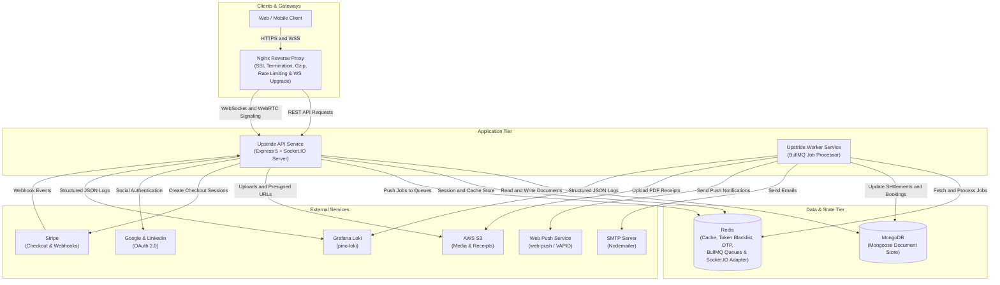
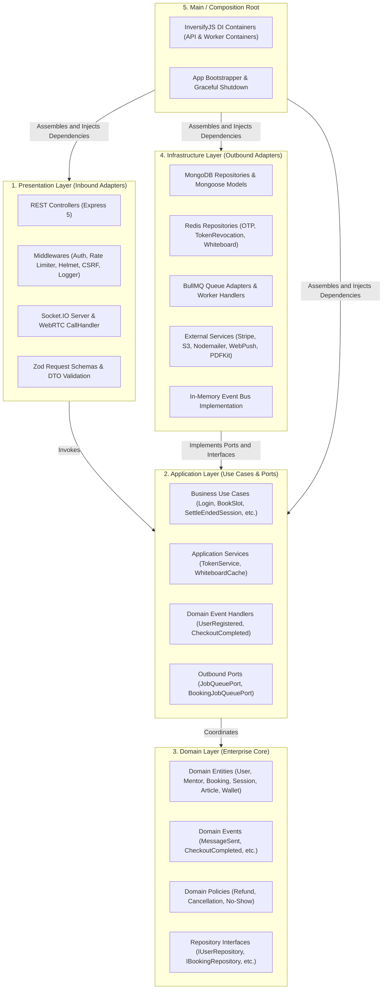

# System Architecture

Upstride Backend is engineered following **Clean Architecture (Hexagonal / Ports and Adapters)**, **Domain-Driven Design (DDD)** principles, and an **Event-Driven Architecture**.

The system separates concerns cleanly: business logic remains independent of external frameworks, databases, messaging queues, and UI protocols.

---

## High-Level System Topology

The platform separates the **REST / WebSocket API server** and the **Background Worker** into isolated, independently scalable processes coordinated via Redis and MongoDB.

---

## Clean Architecture Layers

Dependencies point strictly inward toward the domain layer. Outer layers can depend on inner layers, but inner layers have zero knowledge of external frameworks or libraries.

### 1. Domain Layer (`src/domain`)

- **Entities**: Pure TypeScript classes encapsulating enterprise business rules (e.g., `User`, `Mentor`, `Booking`, `Session`, `Wallet`, `Article`).
- **Domain Events**: Dispatched when critical domain state transitions occur (e.g., `UserRegisteredEvent`, `CheckoutCompletedEvent`, `SessionRefundedEvent`, `MessageSentEvent`).
- **Policies**: Domain logic rules governing domain operations (e.g., OTP validation rules, refund calculations, mentor no-show policies).
- **Repository Interfaces**: Abstract contracts defining repository capabilities without binding to a database vendor.

### 2. Application Layer (`src/application`)

- **Use Cases**: Encapsulate application-specific workflows and orchestrate domain entities and repository interfaces.
- **Ports**: Inbound and outbound abstraction boundaries (e.g., `JobQueuePort`, `BookingJobQueuePort`).
- **Domain Event Handlers**: Decouple domain side effects (such as sending an email or issuing an in-app notification) from use case execution.
- **Data Transfer Objects (DTOs)**: Typed input/output contracts passed across layer boundaries.

### 3. Infrastructure Layer (`src/infrastructure`)

- **Persistence**: MongoDB repositories with Mongoose schemas and entity mappers.
- **Cache & Ephemeral State**: Redis implementations for OTP management, token revocation blacklisting, and live whiteboard state caching.
- **Queues & Workers**: BullMQ queue adapters and background worker handlers for notification and settlement pipelines.
- **External Services**: Integrations with Stripe, AWS S3, Nodemailer, WebPush, Google/LinkedIn OAuth, and PDFKit.

### 4. Presentation Layer (`src/presentation`)

- **HTTP**: Express 5 controllers, route definitions, error handlers, and security middlewares (rate limiting, helmet, cookie-parser, CORS, request logging).
- **WebSockets**: Socket.IO server configured with `@socket.io/redis-adapter` for multi-instance horizontal scaling, handling WebRTC signaling and real-time whiteboard collaboration.

### 5. Main / Composition Root (`src/main`)

- **Dependency Injection**: Uses InversifyJS containers (`apiContainer` and `workerContainer`) to resolve interfaces to concrete implementations at application startup.
- **Graceful Shutdown**: Intercepts `SIGTERM` and `SIGINT` to cleanly close HTTP listeners, WebSocket rooms, active worker queues, MongoDB connections, and Redis clients.

---

## Reverse Proxy & Gateway Layer (`nginx/`)

Production deployments route incoming traffic through **Nginx**, configured via `nginx/upstride-api.conf` and `nginx/upstride-http.conf`:
- **SSL Termination & Security**: Manages TLS certificates (Certbot) and injects hardened HTTP headers (`X-Frame-Options`, `X-Content-Type-Options`, `Referrer-Policy`).
- **WebSocket Upgrade Routing**: Proxies `/socket.io/` connections with connection upgrade headers, disabled buffering, and extended timeouts (86400s) for persistent WebRTC signaling channels.
- **Differentiated Traffic Limits**: Implements per-IP connection limits, dedicated non-limited passthrough for `/api/webhooks/stripe`, and stricter rate limiting for authentication endpoints (`/api/v1/auth/`).
- **Performance Optimization**: Enables Gzip compression for JSON payloads and static assets, and maintains persistent keepalive connections (64) to the upstream backend service.
