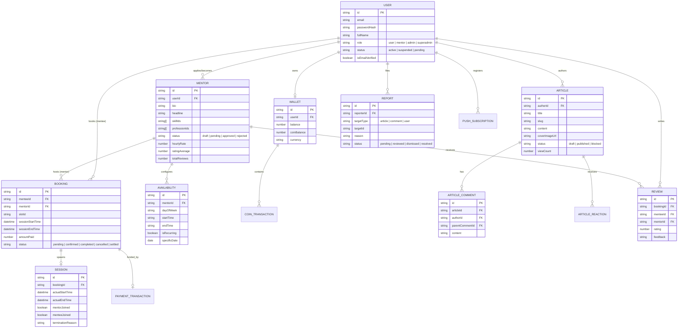

# Domain Data Model

Upstride utilizes a hybrid persistence architecture: **MongoDB** acts as the primary document database for core entities, while **Redis** serves as an ultra-fast store for ephemeral data (OTP codes, token revocation blacklists, rate limits, and live whiteboard state).

---

## Entity Relationship Diagram (ERD)

---

## Core Domain Entities

| Entity                 | Description                                                                                 | Key Attributes                                                                                                |
| ---------------------- | ------------------------------------------------------------------------------------------- | ------------------------------------------------------------------------------------------------------------- |
| **User**               | Core identity entity representing platform members (mentees, mentors, admins, superadmins). | `id`, `email`, `fullName`, `role`, `status`, `avatarUrl`, `isEmailVerified`                                   |
| **Mentor**             | Extended profile for vetted mentors containing professional details and ratings.            | `userId`, `headline`, `bio`, `skills`, `professions`, `hourlyRate`, `ratingAverage`, `totalReviews`, `status` |
| **Availability**       | Defines available time blocks for mentorship bookings (recurring weekly or specific dates). | `mentorId`, `dayOfWeek`, `startTime`, `endTime`, `isRecurring`, `specificDate`                                |
| **Booking**            | Represents an agreement between a mentee and mentor for a scheduled session.                | `menteeId`, `mentorId`, `slotId`, `sessionStartTime`, `sessionEndTime`, `amountPaid`, `status`                |
| **Session**            | Live video session telemetry tracking actual attendance and call metrics.                   | `bookingId`, `actualStartTime`, `actualEndTime`, `mentorJoined`, `menteeJoined`, `terminationReason`          |
| **Wallet**             | Financial ledger entity tracking available cash balance and platform coins.                 | `userId`, `balance`, `coinBalance`, `currency`                                                                |
| **PaymentTransaction** | Immutable audit record for payments, payouts, and refunds.                                  | `walletId`, `stripeSessionId`, `amount`, `type`, `status`                                                     |
| **Article**            | User-generated content feed item with rich markdown support.                                | `authorId`, `title`, `slug`, `content`, `coverImageUrl`, `status`, `tags`, `viewCount`                        |
| **Review**             | Post-session rating and qualitative feedback left by mentees for mentors.                   | `bookingId`, `menteeId`, `mentorId`, `rating`, `feedback`                                                     |
| **Report**             | Moderation entity flagged by users for abusive content or bad actors.                       | `reporterId`, `targetType`, `targetId`, `reason`, `status`, `resolutionNotes`                                 |

---

## Ephemeral Storage (Redis)

| Key Pattern                | Purpose                                                                | Expiration / TTL          |
| -------------------------- | ---------------------------------------------------------------------- | ------------------------- |
| `otp:{purpose}:{email}`    | Transient verification codes for registration and password changes     | 5 minutes                 |
| `revoked_token:{jti}`      | Blacklisted JWT access/refresh token IDs upon logout or password reset | Remaining token lifetime  |
| `whiteboard:{bookingId}`   | Real-time vector drawing state for active video sessions               | Session duration + buffer |
| `rate_limit:{ip}:{window}` | Sliding window request counts for DDoS and brute-force mitigation      | 60 seconds                |
