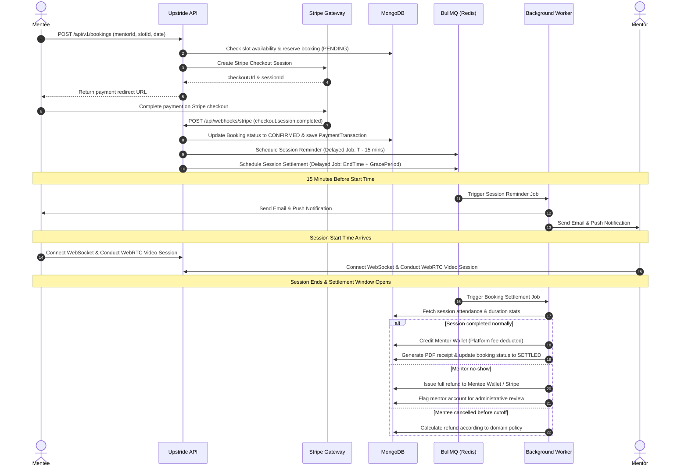
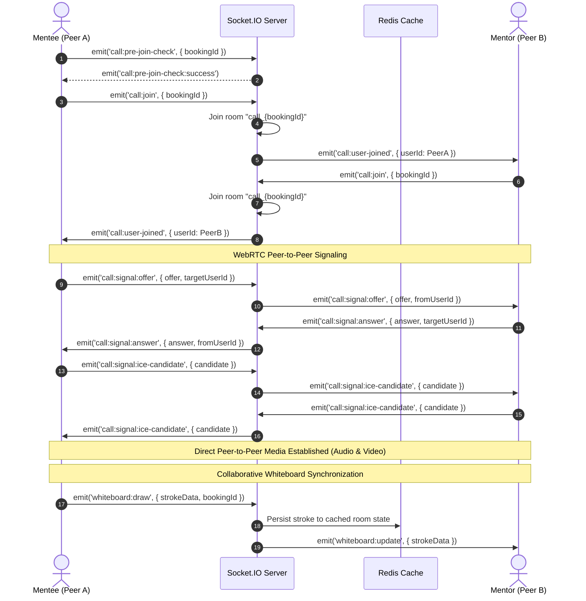
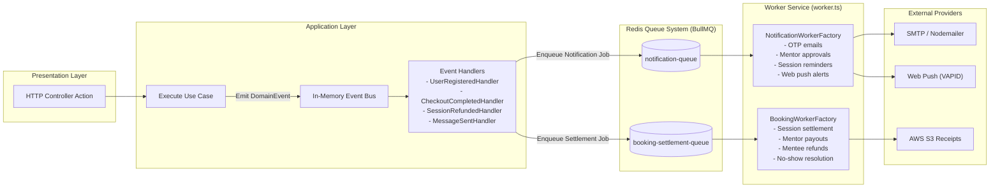

# Core Workflows & Lifecycles

This document details the primary business workflows and technical lifecycles across Upstride Backend with sequence and flow diagrams.

---

## 1. Booking, Payment & Settlement Lifecycle

Mentorship sessions transition through four discrete phases: **Reservation & Payment**, **Scheduling & Reminders**, **Live Collaboration**, and **Post-Session Settlement**.

### Key Phases:

1. **Slot Locking**: When a mentee initiates a booking, the slot is locked into a pending state to prevent race conditions or double-bookings.
2. **Payment Reconciliation**: Stripe webhooks verify signature integrity and safely mutate booking records within database transactions.
3. **Delayed Job Scheduling**: BullMQ schedules dual delayed jobs:
   - `SessionReminderJob`: Sends localized reminders 15 minutes before session start.
   - `BookingSettlementJob`: Fires after the scheduled end time plus a grace window.
4. **Automated Settlement & No-Show Handling**:
   - Compares session join timestamps of mentor and mentee.
   - Computes platform commissions, credits the mentor's digital wallet, or issues full/partial refunds according to cancellation policies.
   - Generates a PDF receipt stored on AWS S3.

---

## 2. WebRTC Video Call & Collaborative Whiteboard Flow

Real-time audio/video streaming relies on peer-to-peer WebRTC connections established via Socket.IO signaling, while whiteboard vector state is synchronized through a Redis-backed room cache.

### Key Phases:

1. **Pre-Join Authorization**: Validates user identity and verifies whether the caller is an active participant in the scheduled booking.
2. **Room Clustering**: Socket.IO uses the Redis Sharded Adapter (`@socket.io/redis-adapter`) to scale rooms horizontally across multiple node instances.
3. **Signaling Exchange**: SDP Offers, Answers, and ICE candidates are relayed directly between peers without media traversing the application server.
4. **Whiteboard Caching**: Vector stroke data is streamed to room peers and cached in Redis so late-joiners or reconnected users instantly receive the latest canvas state.

---

## 3. Asynchronous Event-Driven & BullMQ Worker Architecture

Domain events decouple synchronous request handling from background tasks such as email delivery, push alerts, and ledger calculations.

### Benefits:

- **Zero Request Latency Overhead**: HTTP responses return immediately without waiting for SMTP or PDFKit operations.
- **Reliability & Retries**: Failed email deliveries or payment jobs automatically retry with exponential backoff via BullMQ.
- **Process Isolation**: The background worker process (`pnpm run start:worker`) runs independently from the HTTP API server (`pnpm run start`).
